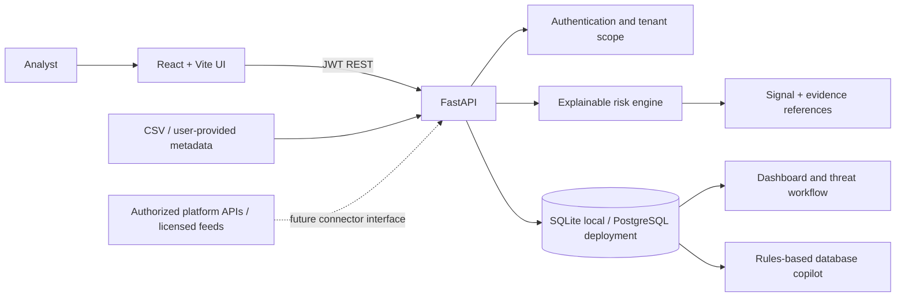

# BrandShield X architecture

## Trust boundaries

- Browser is untrusted; backend checks token and scopes database queries by organization.
- Submitted URLs/descriptions are treated as data. This MVP does not fetch arbitrary URLs.
- CSV is size-limited and parsed as data; uploaded files are not executed.
- Threat scoring is heuristic and creates evidence references for each matched rule.
- External reporting, takedown and other response actions are intentionally not automated.

